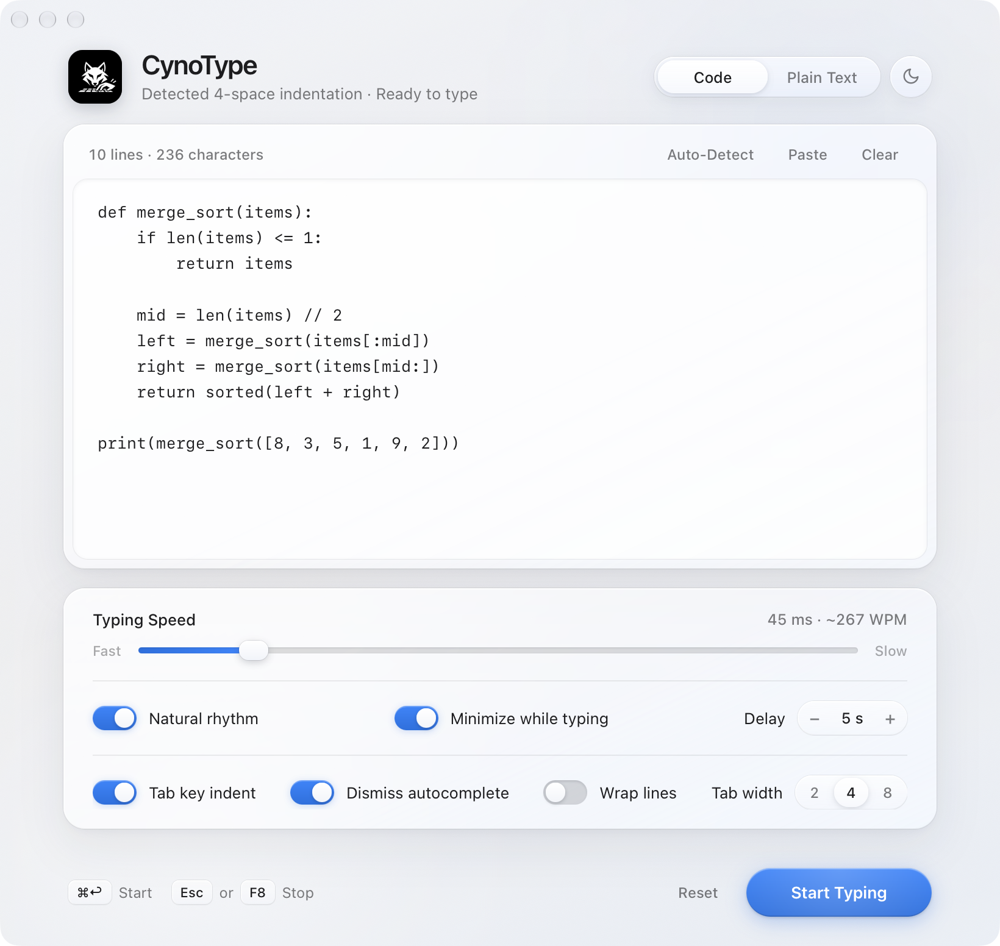
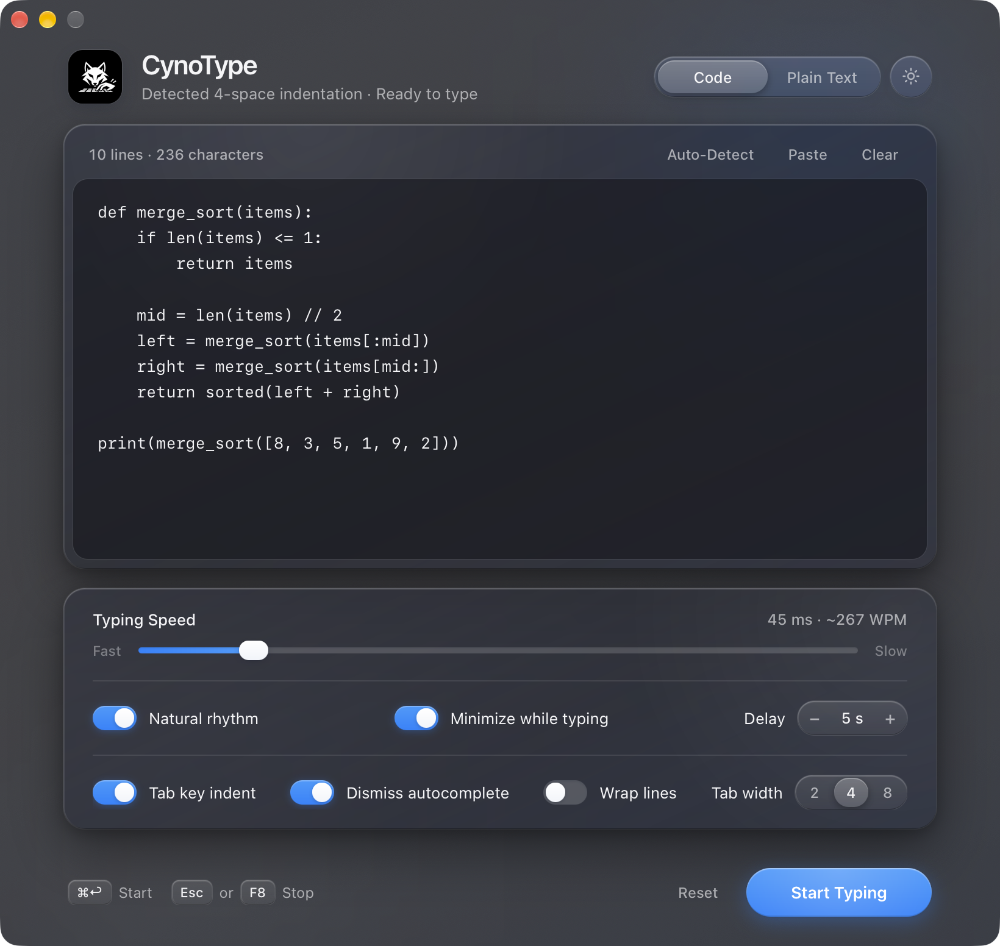
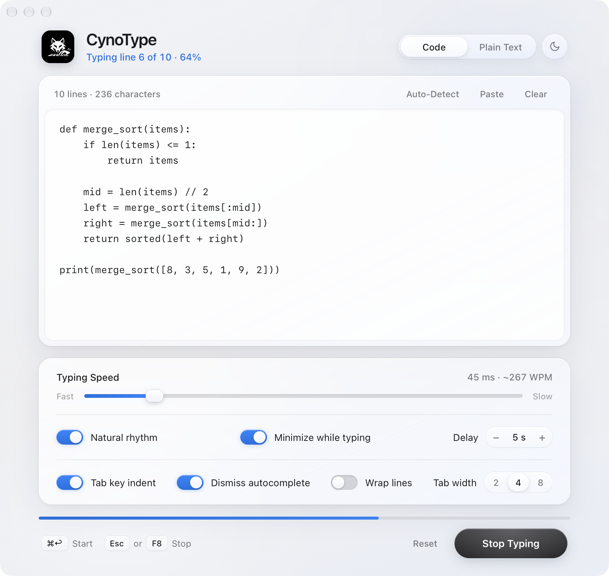
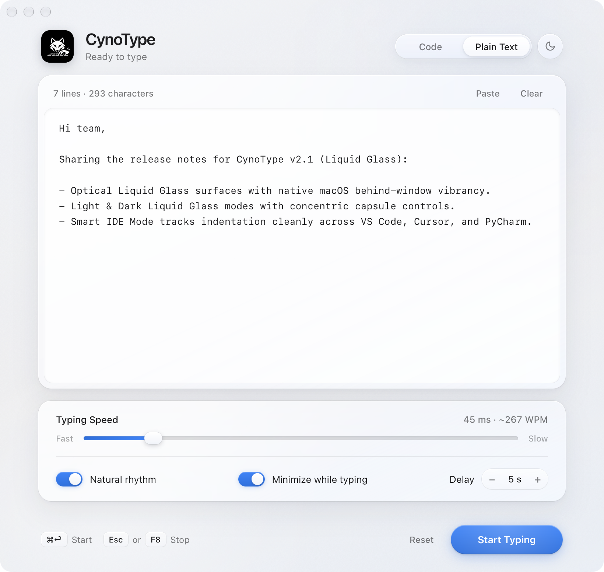

<p align="center">
  
</p>

<h1 align="center">CynoType</h1>

<p align="center">
  <strong>Human &amp; Smart IDE Auto Typer for macOS, Windows, and AI Agents (MCP)</strong><br />
  Simulate realistic keystrokes, preserve exact IDE indentation, and drive browser inputs via Model Context Protocol.
</p>

<p align="center">
  <a href="https://github.com/ChamupathiD/CynoType/releases/latest/download/CynoType-Installer.dmg"><strong>Download for macOS (.dmg)</strong></a>
  &nbsp;&middot;&nbsp;
  <a href="https://github.com/ChamupathiD/CynoType/releases/latest/download/CynoType.exe"><strong>Download for Windows (.exe)</strong></a>
  &nbsp;&middot;&nbsp;
  <a href="https://github.com/ChamupathiD/CynoType/releases/latest">All Releases</a>
</p>

---

## Download

No Python or library installation required — just download and open:

| Platform | Direct Download | Notes |
|---|---|---|
| **macOS** | [**CynoType-Installer.dmg**](https://github.com/ChamupathiD/CynoType/releases/latest/download/CynoType-Installer.dmg) | Drag **CynoType** to **Applications**. First launch: Right-click → Open. |
| **Windows** | [**CynoType.exe**](https://github.com/ChamupathiD/CynoType/releases/latest/download/CynoType.exe) | Standalone portable executable (Windows 10 / 11 with built-in WebView2). |

Browse all versions and SHA-256 checksums on the [GitHub Releases page](https://github.com/ChamupathiD/CynoType/releases).

---

## Interface & Features

<table>
  <tr>
    <td align="center" width="50%">
      
      <br />
      <sub><strong>Light Liquid Glass (Code Mode)</strong> — Translucent frosted glass panels over native macOS vibrancy with Smart IDE indentation.</sub>
    </td>
    <td align="center" width="50%">
      
      <br />
      <sub><strong>Dark Liquid Glass</strong> — Smoked obsidian glass with specular rim lighting, toggled with one click from the header orb.</sub>
    </td>
  </tr>
  <tr>
    <td align="center" width="50%">
      
      <br />
      <sub><strong>Live Progress &amp; Instant Stop</strong> — Luminous progress hairline, live line counter, and global <code>Esc</code> / <code>F8</code> emergency stop.</sub>
    </td>
    <td align="center" width="50%">
      
      <br />
      <sub><strong>Plain Text Mode</strong> — IDE indentation controls collapse smoothly for distraction-free verbatim typing.</sub>
    </td>
  </tr>
</table>

---

## Overview

**CynoType** combines the Smart IDE indentation engine from [`chanul212/Auto-Typer`](https://github.com/chanul212/Auto-Typer) (v2) with a calm, minimal interface inspired by Apple's design principles, native standalone installers for macOS and Windows, and a built-in **MCP server** for AI-controlled browser and desktop typing.

### Key Highlights

- **Smart IDE Mode (`Code`)** — Tracks cursor indentation across lines in VS Code, Cursor, PyCharm, Xcode, and browser IDEs (Monaco / CodeMirror) to eliminate double indentation without collapsing or deleting lines.
- **Plain Text Mode** — Verbatim line-by-line typing preserving exact spacing, tabs, and line endings.
- **Auto-Detect Indentation** — Analyzes pasted code for Tabs, 2-space (JS/TS/Web), or 4-space (Python/Swift/Java) indentation automatically.
- **Natural Human Rhythm** — Gaussian keystroke jitter plus realistic pauses at punctuation, clauses, and line breaks.
- **macOS Liquid Glass UI** — Native full-bleed macOS Cocoa window (`NSVisualEffectView` + `WKWebView`) and Windows Edge WebView2 (`pywebview`) featuring translucent Liquid Glass panels, specular rim highlights, concentric capsule controls, and one-click **Light / Dark Liquid Glass** appearance switching.
- **Global Emergency Stop** — Instant `Esc` or `F8` stop via macOS Quartz Event Tap (ignoring synthetic `Esc` presses used to close autocomplete popups) and global `F8` on Windows.
- **MCP Server + Browser Control** — 14 Model Context Protocol tools allowing AI assistants to inspect editable fields and type via Chrome DevTools Protocol (CDP) or OS keystrokes with domain allowlists, password-field protection, and local audit logging.

---

## Documentation

| Guide | What it covers |
|---|---|
| **[User Guide](docs/USER_GUIDE.md)** | Installing `.dmg` / `.exe`, macOS permissions, Smart IDE vs Plain Text mode, and troubleshooting |
| **[MCP Server Guide](docs/MCP_GUIDE.md)** | Connecting Claude Desktop / Cursor / VS Code / Antigravity, Chrome CDP setup, all 14 MCP tools, and safety guardrails |
| **[Architecture & Build Guide](docs/ARCHITECTURE.md)** | Module layout, UI design tokens, native bridges, PyInstaller packaging, and GitHub Actions releases |

---

## Quick Start

### macOS (End Users — No Setup Required)
1. Download [**`CynoType-Installer.dmg`**](https://github.com/ChamupathiD/CynoType/releases/latest/download/CynoType-Installer.dmg) (or build locally with `./build_mac.sh`).
2. Double-click the `.dmg` and drag **CynoType** into **Applications**.
3. Open **CynoType** *(first launch: Right-click → Open → Open)*.
4. Click **Open Settings** in the in-app banner to grant one-time permissions:
   - **Privacy & Security → Accessibility** → enable **CynoType**
   - **Privacy & Security → Input Monitoring** → enable **CynoType**

### Windows (End Users — No Setup Required)
1. Download [**`CynoType.exe`**](https://github.com/ChamupathiD/CynoType/releases/latest/download/CynoType.exe) (or build on Windows with `build_win.bat`).
2. Double-click **`CynoType.exe`** (uses Microsoft Edge WebView2 built into Windows 10 & 11).

### Run from Source (Developers)
```bash
# macOS
chmod +x setup_mac.sh run_mac.command build_mac.sh
./setup_mac.sh
./run_mac.command

# Windows
python -m pip install -r requirements.txt
python auto_typer.py
```

### Run the MCP Server
```bash
.venv/bin/python -m pip install -r requirements-mcp.txt
.venv/bin/python run_mcp.py
```
See the **[MCP Server Guide](docs/MCP_GUIDE.md)** for full client configuration snippets and Chrome CDP setup.

---

## Keyboard Shortcuts

| Action | macOS | Windows |
|---|---|---|
| Start typing | `⌘ Return` or `F6` | `Ctrl + Enter` or `F6` |
| Emergency stop (global) | `Esc` or `F8` (`fn + F8`) | `F8` |
| Indent / Unindent selection | `Tab` / `⇧ Tab` | `Tab` / `Shift + Tab` |

---

## Project Structure

```text
Auto-Typer/
├── .github/workflows/build-release.yml   # Automated Windows .exe & macOS .dmg builds
├── assets/
│   ├── CynoType.icns                     # macOS squircle app icon
│   ├── CynoType.ico                      # Multi-resolution Windows icon (16–256px)
│   ├── dmg_background.png                # Retina macOS DMG installer background
│   ├── logo.png                          # Master squircle logo
│   ├── logo_mark.png                     # In-app header emblem
│   └── ui.html                           # Shared Apple Design Science UI
├── cynotype/
│   ├── __init__.py
│   ├── engine.py                         # Shared TypingEngine, Smart IDE tracker, OS driver, Quartz hotkey listener
│   ├── browser_controller.py             # Playwright / CDP browser inspection, focus, typing, and safety policy
│   └── mcp_server.py                     # FastMCP / MCPServer v2 exposing 14 browser & typing tools
├── docs/
│   ├── ARCHITECTURE.md
│   ├── MCP_GUIDE.md
│   └── USER_GUIDE.md
├── auto_typer.py                         # Desktop application (macOS Cocoa, Windows WebView2, Tk fallback)
├── build_mac.sh                          # Builds dist/CynoType.app & dist/CynoType-Installer.dmg
├── build_win.bat                         # Builds dist\CynoType.exe
├── requirements.txt                      # Lightweight desktop runtime dependencies
├── requirements-mcp.txt                  # Optional MCP + Playwright dependencies
├── run_mac.command                       # Double-click macOS launcher from source
├── run_mcp.py                            # Stdio MCP server entry point
└── setup_mac.sh                          # One-time macOS developer environment setup
```

---

## Credits

- Original Windows Auto Typer & v2 Smart IDE Indentation algorithm by [`chanul212/Auto-Typer`](https://github.com/chanul212/Auto-Typer).
- macOS port, CynoType Apple Design Science UI redesign, standalone `.dmg` / `.exe` packaging, and MCP browser control server.
