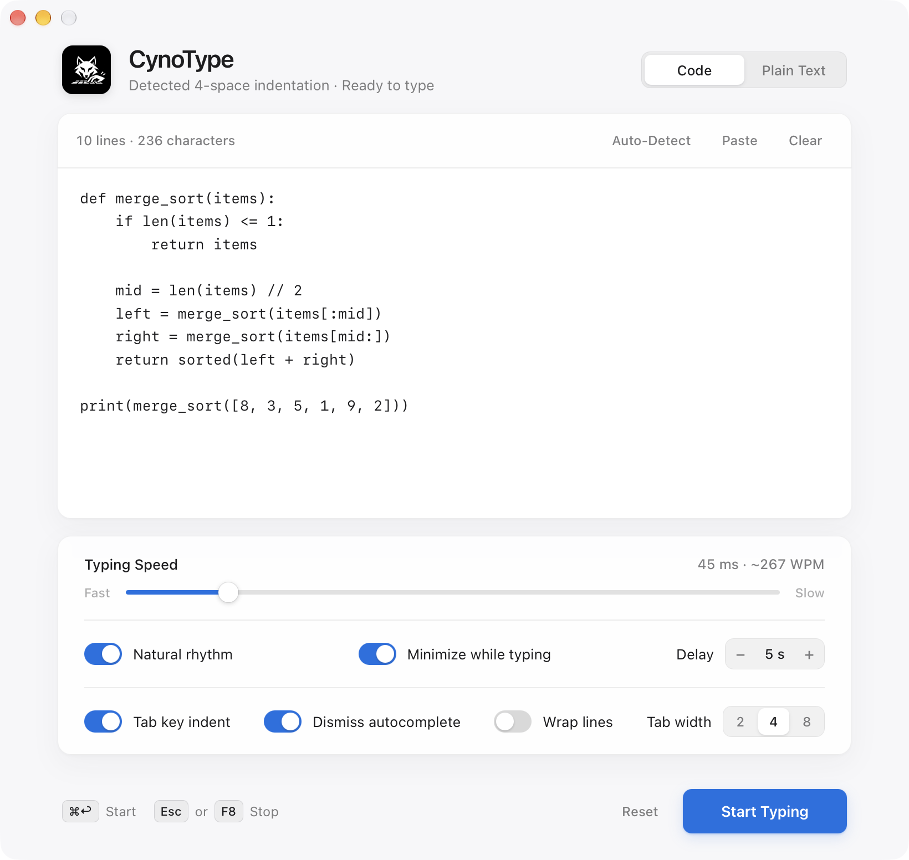
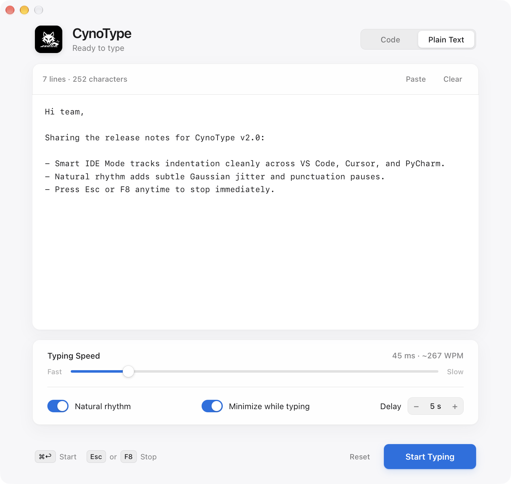
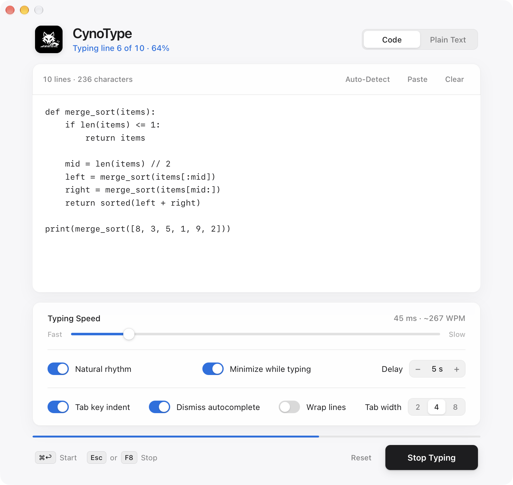

# CynoType User Guide

This guide covers installing CynoType on macOS and Windows, configuring permissions, and getting clean results in both code editors and plain text apps.

---

## 1. Installation

### macOS (`CynoType-Installer.dmg`)
1. Download **`CynoType-Installer.dmg`**.
2. Double-click the `.dmg` file to mount the installer window.
3. Drag **CynoType** onto the **Applications** folder icon.
4. Eject the installer volume and open **CynoType** from **Applications**.
5. **First launch on macOS Gatekeeper**: Because the standalone app is ad-hoc signed rather than notarized with a paid Apple Developer ID, right-click (or Control-click) **CynoType** in Applications and choose **Open → Open**. You only need to do this once.

#### One-Time macOS Privacy Permissions
macOS restricts apps from synthesizing keystrokes or listening for global stop shortcuts until explicitly permitted. When CynoType detects missing permissions, a quiet notice appears at the top of the window with an **Open Settings** button:

1. **System Settings → Privacy & Security → Accessibility** → toggle **CynoType** ON *(required to type)*.
2. **System Settings → Privacy & Security → Input Monitoring** → toggle **CynoType** ON *(required for global `Esc` / `F8` emergency stop)*.
3. **Quit (`⌘Q`) and reopen CynoType** once after toggling permissions on.

> **Running from source (`./run_mac.command`)?** Enable **Terminal** (or iTerm / VS Code, whichever app launches Python) in both Accessibility and Input Monitoring.

### Windows (`CynoType.exe`)
1. Download **`CynoType.exe`** from GitHub Releases or GitHub Actions artifacts (or build locally with `build_win.bat`).
2. Double-click **`CynoType.exe`**. No Python installation is required — the interface uses Microsoft Edge WebView2, which is pre-installed on Windows 10 and 11.
3. If Windows SmartScreen prompts on first run, click **More info → Run anyway**.

---

## 2. Typing Modes

Switch modes anytime using the **Code | Plain Text** segmented control in the top-right corner of the window.

### Code Mode (Smart IDE Indentation)
Best for **VS Code, Cursor, PyCharm, IntelliJ, Xcode, Replit, CodeSandbox, and browser Monaco/CodeMirror editors**.

  

Modern IDEs automatically indent new lines after block openers (`:`, `{`, `(`, `[`) and keep the previous line's indentation on Enter. Standard auto-typers blindly re-type all leading spaces, causing indentation to double on every line.

CynoType's Smart IDE Mode prevents this by tracking the editor's indentation state line by line:
- Detects block openers (`:`, `{`, `(`, `[`) while ignoring inline `#` and `//` comments outside string literals.
- Types only the **delta** when indentation increases (using `Tab` or spaces per your setting).
- Sends exact `Backspace` unindents when indentation decreases.
- Keeps blank lines intact without collapsing lines.

#### Code Mode Controls
- **Auto-Detect**: Analyzes the code in the editor and automatically configures **Tab width** (`2` for JS/TS/React/HTML, `4` for Python/Swift/Java/C++) and **Tab key indent** (enabled if leading tabs are detected). Runs automatically when pasting into an empty editor in Code mode.
- **Tab key indent**: Sends the physical `Tab` key for each full indent level instead of individual spaces.
- **Dismiss autocomplete**: Presses `Esc` right before `Enter` to dismiss IntelliSense / Copilot / autocomplete popups so `Enter` inserts a newline instead of accepting an unwanted suggestion. *(Tip: Turn this OFF in Jupyter Notebook / Google Colab, where `Esc` switches to Command Mode.)*
- **Wrap lines**: Keeps long code lines unwrapped by default (with horizontal + vertical scrolling) so indentation structure stays visually clear. Toggle ON to soft-wrap.
- **Tab width (`2` / `4` / `8`)**: Sets both editor visual tab stops and the Smart IDE indentation step size.

### Plain Text Mode (Verbatim)
Best for **Google Docs, Notion, Notes, Notepad, email clients, chat apps, and forms**.

  

Types every character, space, tab, and newline verbatim with natural cadence — never modifying indentation or pressing `Esc`.

---

## 3. Speed, Rhythm & Window Behavior

  

- **Typing Speed (`10 ms` – `250 ms`)**: Controls base delay per keystroke and displays the approximate typing speed in WPM.
- **Natural rhythm**: Adds realistic Gaussian timing jitter plus brief pauses after sentence endings (`.`, `!`, `?`), clauses (`,`, `;`, `:`, `-`), and line breaks.
- **Minimize while typing**: Automatically minimizes CynoType when the countdown starts so you can click into your target window, then restores CynoType to the front when finished or stopped.
- **Delay (`1 s` – `30 s`)**: Countdown before the first keystroke is sent (default `5 s`).
- **Reset**: Stops any active job, clears the editor (with confirmation if non-empty), and restores all settings to defaults.

---

## 4. Emergency Stop

- **macOS**: Press **`Esc`** or **`F8`** (`fn + F8` on compact Mac keyboards) at any time — even while CynoType is minimized or another app is focused. Synthetic `Esc` keys sent by CynoType to dismiss autocomplete popups are automatically filtered out and will never trigger a false stop.
- **Windows**: Press **`F8`** globally at any time.
- Clicking **Stop Typing** inside the window also halts immediately and releases all modifier keys.

---

## 5. Troubleshooting

| Issue | Solution |
|---|---|
| Nothing types on macOS | Open **System Settings → Privacy & Security → Accessibility**, enable **CynoType**, then quit (`⌘Q`) and reopen the app. |
| `Esc` / `F8` doesn't stop typing when unfocused on macOS | Enable **CynoType** in **System Settings → Privacy & Security → Input Monitoring**, then quit and reopen. |
| Indentation is slightly off in a specific IDE | Click **Auto-Detect** (or match **Tab width** to your IDE's setting) and start with your cursor at column 0 on an empty line. |
| Jupyter / Colab exits edit mode on new lines | Turn **Dismiss autocomplete** OFF in Code mode settings. |
| Special symbols or emojis fail to type | CynoType automatically falls back to clipboard paste (`⌘V` / `Ctrl+V`) for characters unsupported by the active keyboard layout and restores your original clipboard afterward. |
